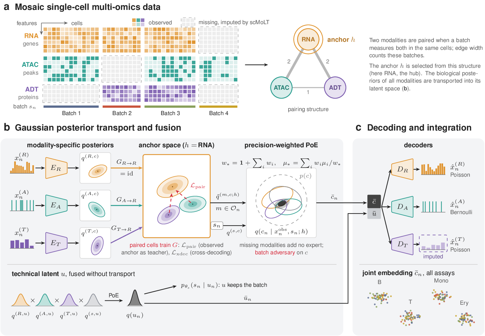

# scMoLT: Gaussian posterior transport for mosaic integration of single-cell multi-omics data




Single-cell multi-omics studies rarely measure every modality in every cell. A CITE-seq batch measures RNA and
surface proteins (ADT), a Multiome batch measures RNA and chromatin accessibility (ATAC), and integrating such
*mosaic* data means placing all cells in one space while predicting the modalities each batch did not measure.
**scMoLT** encodes every measured modality into a Gaussian posterior with a biological and a technical part. Before
fusion, learned maps transport the mean and variance of each biological posterior into the latent space of an
*anchor* modality, where cells that measure both modalities teach the maps. A precision-weighted product of experts
then fuses the transported posteriors, and modality-specific decoders reconstruct the measured modalities and predict
the missing ones.

**Highlights**

- Learns a Gaussian transport $G_{m\to h}$ of each modality's biological posterior into the anchor space $h$, trained
  by paired cells, cross-decoding, cycle consistency and transport adversaries, before a prior-inclusive product of
  experts (Fig. a–b).
- Keeps a 2-dimensional technical latent, fused without transport, apart from the 32-dimensional biological embedding
  used for integration.
- Integrates mosaics of RNA, ADT and ATAC batches and predicts the missing modalities of every cell.
- Builds on the encoders, decoders and data handling of [scMIDAS](https://github.com/labomics/midas) 0.1.13; one
  65-epoch run on 36,951 bone marrow cells takes about 40 minutes on a single GPU.

## Installation

scMoLT needs Python 3.10–3.12. Install [PyTorch](https://pytorch.org) for your platform first, then

```bash
pip install git+https://github.com/punyung/scmolt.git
```

or, to run the tests,

```bash
git clone https://github.com/punyung/scmolt.git
cd scmolt
pip install -e ".[test]"
pytest
```

The paper's experiments ran in the environment of [`environment.yml`](environment.yml) (Python 3.10, PyTorch 2.8.0
with CUDA 12.8, scMIDAS 0.1.13): `conda env create -f environment.yml`. The training commands check the installed
package versions against this environment and stop if they differ. Add `--allow-runtime-drift` to run with other
versions, as in the commands below; the run records the versions it used.

## Quick start

A synthetic input with four small batches (RNA + ATAC, RNA + ADT, ATAC + ADT and ATAC only) trains for the full 65
epochs in under a minute on a CPU:

```bash
scmolt-make-tiny-input --output-dir tiny_input
PYTHONHASHSEED=1234 scmolt-train --input-dir tiny_input --output-dir tiny_run --device cpu --allow-runtime-drift
```

`tiny_run/` then contains the model (`model_state_epoch65.pt`), the training history and `predictions.h5`, with the
embedding of every cell and the predicted values of every modality that a batch does not measure:

```python
import scmolt

embedding, imputed = scmolt.read_predictions("tiny_run/predictions.h5", input_dir="tiny_input")
embedding.obsm["X_scmolt"]   # 32-dimensional biological embedding of all 64 cells
imputed["adt"]               # AnnData: predicted ADT of the batches without ADT
```

## Your own data

The runners read the native input directory of MIDAS: one folder per batch with a matrix for each modality the batch
measures. `scmolt.write_midas_input` writes it from one AnnData per modality. Each AnnData holds the cells in which
the modality was measured, with raw counts for RNA and ADT (in `layers["counts"]` or `X`), peaks for ATAC
(binarized on writing, sorted by chromosome) and the batch of every cell in `obs`.

```python
import scmolt

scmolt.write_midas_input({"rna": rna, "adt": adt, "atac": atac}, "my_input", batch_key="batch")
```

```bash
PYTHONHASHSEED=1234 scmolt-train --input-dir my_input --output-dir my_run --device cuda --allow-runtime-drift
```

The same is available on the command line as `scmolt prepare-input --rna rna.h5ad --adt adt.h5ad --atac atac.h5ad
--output-dir my_input`. `scmolt-train` uses RNA as the anchor and needs all three modalities, each measured in at
least one batch. It trains with the settings of the paper (seed 1234, 65 epochs with 30 warm-up and 30 ramp epochs,
minibatches of 256 cells) and has no options to change them. `scmolt-predict --input-dir my_input --checkpoint
my_run/model_state_epoch65.pt --output-dir my_pred` recomputes the predictions from a saved model. See
[docs/usage.md](docs/usage.md) for the input format, the outputs and the checks that the runners make.

## DOGMA-seq pseudo-mosaics

`scmolt-anchor-train` and `scmolt-anchor-predict` train the models of the eight DOGMA-seq configurations of the paper,
with the anchor that the paper chose for each configuration (`scmolt info`):

| Anchor | Configurations |
|---|---|
| RNA | `full`, `paired-abc`, `paired-ac`, `diagonal+full`, `diagonal` |
| ATAC | `paired+full`, `paired-ab` |
| ADT | `paired-bc` |

`paired-ab`, `paired-bc` and `paired-ac` are the three mosaics of the main text, in which ATAC, ADT or RNA is measured
in all four batches. `scmolt prepare-input --configuration paired-ab ...` masks fully measured DOGMA-seq data to one
of the configurations.

## Reproducing the paper

[`experiments/`](experiments) contains the commands of the DOGMA-seq pseudo-mosaics, the bone marrow (BMMC) CITE-seq
and Multiome application and the PBMC application, from the public data to the trained models and predictions. See
[`experiments/README.md`](experiments/README.md).

## Code map

| Paper | Code (`src/scmolt/`) |
|---|---|
| Encoders, decoders, batch encoder and adversary (scMIDAS 0.1.13) | used through `trackc/model.py` |
| Gaussian posteriors, transport maps $G_{m\to h}$, product of experts | `trackc/gaussian.py`, `trackc/modules.py`, `trackc/model.py` |
| Losses and schedule $\alpha_t$ (Supplementary Methods) | `trackc/model.py`, `trackc/config.py` |
| Feature re-masking | `trackc/remasking.py` |
| RNA anchor with the ATAC–ADT maps | `trackc_adbridge/` |
| ATAC anchor, ADT anchor | `trackc_atacgraph*/`, `trackc_adtgraph/` |
| Training and prediction with the RNA anchor (`scmolt-train`) | `frozenbridge65/` |
| DOGMA-seq configurations and anchors (`scmolt-anchor-train`) | `anchor_conditioned/` |
| AnnData input and output | `data.py` |

## Citation

```bibtex
@inproceedings{pan2027scmolt,
  title     = {{scMoLT}: Gaussian posterior transport for mosaic integration of single-cell multi-omics data},
  author    = {Pan, Rong and Ma, Tianzhou},
  booktitle = {Research in Computational Molecular Biology (RECOMB 2027)},
  note      = {Under review},
  year      = {2027}
}
```

## License

scMoLT is released under the [MIT License](LICENSE). It uses scMIDAS (MIT License) as a dependency; see
[THIRD_PARTY_NOTICES.md](THIRD_PARTY_NOTICES.md).

## Contact

Questions and issues are welcome on [GitHub](https://github.com/punyung/scmolt/issues).
